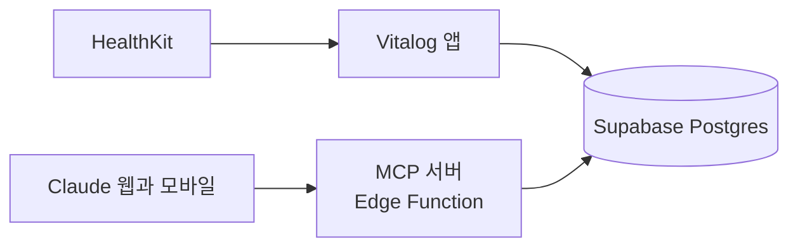

# Vitalog

아이폰 HealthKit 데이터를 직접 만든 iOS 앱으로 Supabase에 동기화하고, Supabase Edge Functions의 원격 MCP 서버를 통해 Claude 웹과 모바일에서 조회하는 개인용 프로젝트입니다.



## 디렉토리 구조

| 경로                                                  | 내용                                                   |
| ----------------------------------------------------- | ------------------------------------------------------ |
| [ios/](ios/README.md)                                 | SwiftUI 앱 (Xcode 프로젝트)                            |
| [supabase/](supabase/README.md)                       | DB 마이그레이션, Supabase 설정, MCP 서버 Edge Function |
| [consent/](supabase/README.md#oauth-서버와-동의-화면) | OAuth 동의 화면 (정적 HTML 한 장)                      |
| [scripts/](ios/README.md#주-1회-재설치) | 주 1회 앱 재설치 스크립트 |
| [docs/](docs/)                                        | DB 설계서, 아키텍처 정의서, 추천 프롬프트              |

## 문서

- [docs/ARCHITECTURE.md](docs/ARCHITECTURE.md): 아키텍처 정의서
- [docs/DB_DESIGN.md](docs/DB_DESIGN.md): DB 설계서
- [docs/PROMPTS.md](docs/PROMPTS.md): MCP 처음 사용자를 위한 추천 프롬프트

각 폴더의 사용법은 [ios/README.md](ios/README.md)와 [supabase/README.md](supabase/README.md)에 있습니다.

## 시작하기

필요한 것: Mac, Xcode, [Supabase](https://supabase.com) 계정, [Supabase CLI](https://supabase.com/docs/guides/cli), HealthKit 데이터가 있는 아이폰(개발자 모드 켬).

1. [supabase.com](https://supabase.com) 대시보드에서 새 프로젝트를 만들고, 프로젝트 ref(주소의 `<ref>.supabase.co` 부분)를 확인합니다.

2. CLI로 로그인하고 프로젝트를 연결한 뒤, DB 스키마를 적용합니다.

   ```bash
   supabase login
   ```

   ```bash
   supabase link --project-ref <프로젝트 ref>
   ```

   ```bash
   supabase db push
   ```

3. 대시보드의 Authentication > Users에서 앱에 로그인할 계정(이메일과 비밀번호)을 만듭니다.

4. 앱 설정 파일을 만들고, 프로젝트 주소와 공개 키를 채웁니다. 공개 키는 대시보드의 Project Settings > API Keys에 있는 Publishable key입니다. 비밀 키(secret)는 넣지 않습니다. 자세한 내용은 [ios/README.md](ios/README.md)를 보세요.

   ```bash
   cp ios/Secrets.xcconfig.example ios/Secrets.xcconfig
   ```

5. 앱을 기기용으로 빌드하고 설치합니다.

   ```bash
   xcodebuild -project ios/Vitalog.xcodeproj -scheme Vitalog -destination 'id=<기기 UDID>' -derivedDataPath build -allowProvisioningUpdates build
   ```

   ```bash
   xcrun devicectl device install app --device <기기 UDID> build/Build/Products/Debug-iphoneos/Vitalog.app
   ```

6. 아이폰을 충전기에 꽂고 화면을 켠 채 앱을 열어 로그인한 뒤 최초 동기화를 시작하면 과거 기록을 올립니다.

무료 플랜은 DB 500MB 한도가 있어서, 앱은 고빈도 원본을 유형별로 최근 기간만 올립니다 ([ios/README.md](ios/README.md)).

기기 UDID와 팀 ID, 번들 ID 같은 프로젝트 값은 `CLAUDE.md`에 있습니다.

## Claude에 연결하기

앱이 올린 데이터를 Claude 웹과 모바일에서 조회하는 설정입니다. 한 번만 하면 됩니다. 각 단계의 자세한 방법은 [supabase/README.md](supabase/README.md)에 있습니다.

1. **MCP 서버 배포**: 확인한 뒤 실행합니다.

   ```bash
   supabase functions deploy vitalog-mcp --no-verify-jwt
   ```

2. **동의 화면 배포**: Claude가 데이터를 읽어도 되는지 사용자가 승인하는 정적 웹 페이지(`consent/`)를 Cloudflare Pages에 올립니다. 올린 주소를 기억해 둡니다.
3. **OAuth 서버 설정** (Supabase 대시보드):
   - Authentication > OAuth Server에서 서버를 켜고, 동의 화면 경로를 `/oauth/consent`로 두고, 동적 등록은 끕니다.
   - Authentication > URL Configuration의 Site URL을 2번의 주소로 맞춥니다.
   - Authentication > OAuth Apps에서 클라이언트를 만듭니다. 종류는 Public이고, 리디렉션 주소는 `https://claude.ai/api/mcp/auth_callback`과 `https://claude.com/api/mcp/auth_callback`입니다. 만들어진 클라이언트 ID를 적어 둡니다.
4. **claude.ai에 커넥터 추가**: 설정 > 커넥터 > 사용자 지정 커넥터 추가(Pro 이상 플랜)에서 아래를 넣습니다.
   - 서버 주소: `https://<프로젝트 ref>.supabase.co/functions/v1/vitalog-mcp`
   - 고급 설정의 OAuth 클라이언트 ID: 3번에서 만든 값 (비밀 키는 비워 둡니다)
   - 추가하면 동의 화면으로 이동합니다. 앱에 쓰는 계정으로 로그인하고 승인합니다.
5. 새 대화에서 질문합니다. 처음에는 [docs/PROMPTS.md](docs/PROMPTS.md)의 "첫 인사"부터 쓰면 어떤 데이터가 있는지 알 수 있습니다. 모바일 claude.ai 앱에도 같은 커넥터가 보입니다.
6. 본인 전용으로 쓴다면 로그인 계정 하나만 두고, Authentication > Sign In / Providers에서 새 사용자 가입을 끕니다.

## 무료 개발자 계정 주의

설치한 앱은 프로파일이 만료되는 7일 뒤부터 실행되지 않습니다. 앱을 지우지 않고 덮어 설치해야 기기에 저장된 동기화 기록이 유지됩니다. 설치된 프로파일이 아직 유효하면 단순히 덮어 설치해도 만료일이 연장되지 않으므로, 매주 아이폰을 Mac에 연결하고 아래 스크립트를 실행합니다.

```bash
scripts/reinstall.sh
```

- 이 앱의 프로파일만 새로 받아 빌드하고, 앱을 지우지 않고 덮어 설치한 뒤, 새 만료 시각과 다음 재설치 권장일을 알려 줍니다.
- 앱 화면의 "상태"에서 마지막 동기화 시각과 만료일을 볼 수 있고, 만료가 2일 이하로 남으면 경고가 뜹니다.
- 요일을 정해 캘린더 반복 알림을 두면 놓치지 않습니다. 자세한 내용은 [ios/README.md](ios/README.md#주-1회-재설치)를 보세요.
