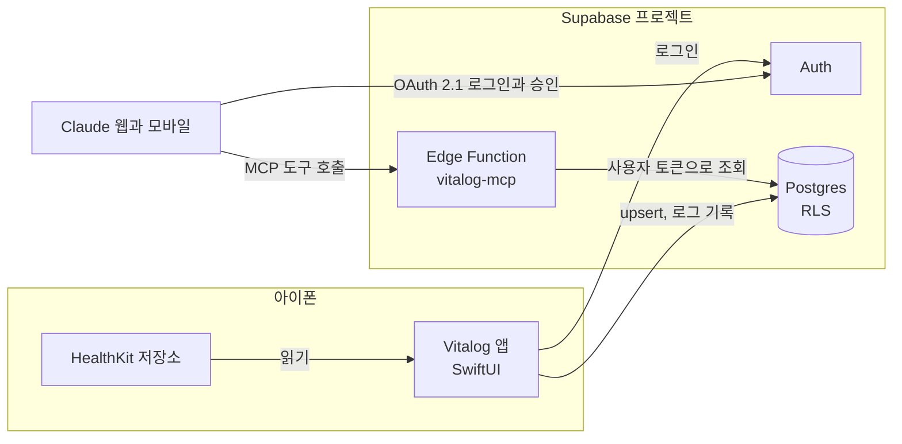
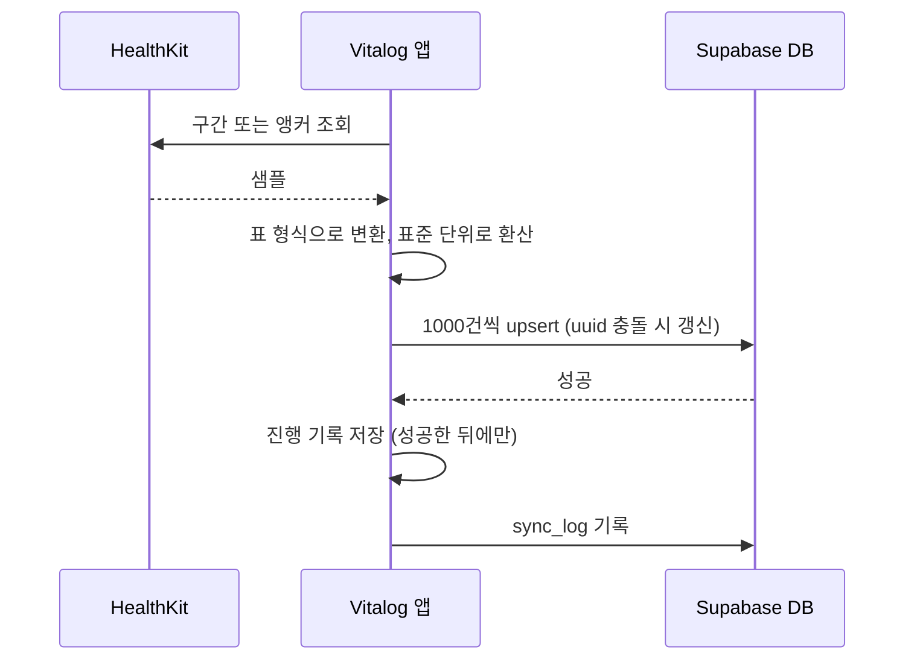
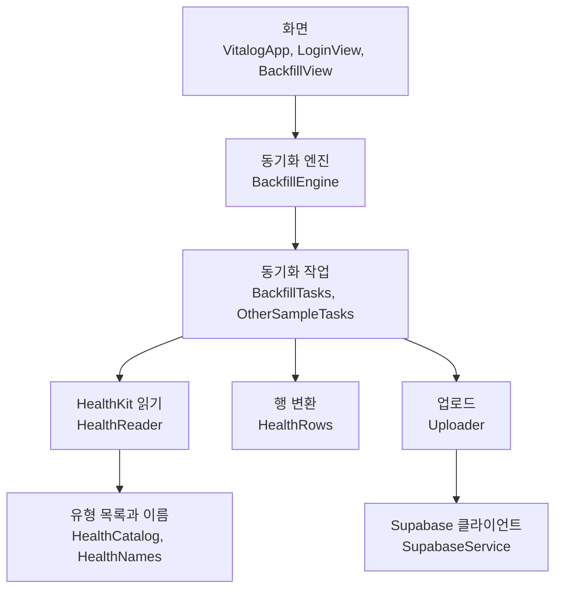
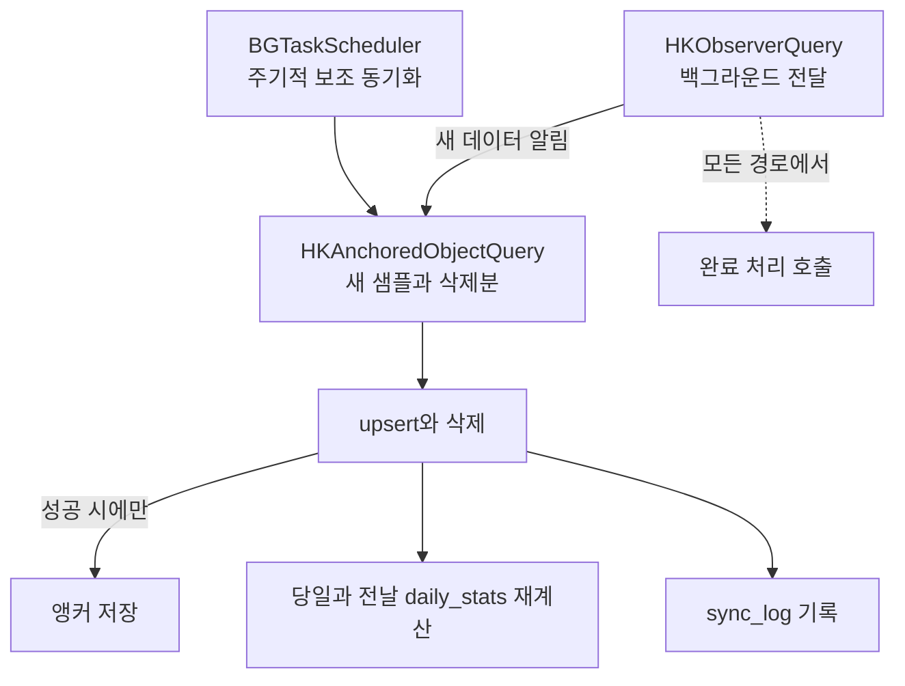

# 아키텍처 정의서

## 1. 시스템 구성

| 구성 요소  | 역할                                                                      | 기술                                        | 상태                                                                  |
| ---------- | ------------------------------------------------------------------------- | ------------------------------------------- | --------------------------------------------------------------------- |
| Vitalog 앱 | HealthKit을 읽어 Supabase로 올립니다.                                     | Swift, SwiftUI, HealthKit, `supabase-swift` | 백필 완료, 증분 동기화 진행 중                                        |
| Postgres   | 원본 샘플과 일별 통계를 저장하고 RLS로 격리합니다.                        | Supabase Postgres                           | 완료 (`DB_DESIGN.md` 참고)                                            |
| Auth       | 앱 로그인과 MCP용 OAuth 2.1 서버                                          | Supabase Auth                               | 앱 로그인 완료, OAuth 서버 설정은 5단계                               |
| 동의 화면  | Claude의 읽기 요청을 로그인한 사용자가 승인하거나 거부하는 정적 웹 페이지 | HTML 한 장, supabase-js                     | 구현과 배포 완료 (`consent/`, Cloudflare Pages) |
| MCP 서버   | 건강 데이터 조회 도구를 Claude에 제공합니다.                              | Supabase Edge Functions, TypeScript, Deno   | 토큰 검증 구현 완료, 배포는 5단계 (`supabase/functions/vitalog-mcp/`) |
| Claude     | 사용자 질문을 도구 호출로 바꿔 답합니다.                                  | claude.ai 사용자 지정 커넥터                | 5단계 예정                                                            |

## 3. 데이터 흐름

### 3.1 쓰기: 아이폰에서 DB로

핵심 규칙은 다음과 같습니다.

- 업로드가 성공한 뒤에만 진행 기록(백필 완료 구간, 앵커)을 저장합니다. 실패하면 같은 구간을 다시 올리지만, upsert라 결과는 같습니다.
- 한 번에 올리는 묶음은 1000건입니다. 네트워크 오류는 1, 2, 4, 8, 16, 32초 간격으로 재시도합니다.
- 합계 지표는 원본이 아니라 HealthKit 통계 조회로 계산한 `daily_stats`로 올립니다.

### 3.2 읽기: Claude에서 DB로 (4~5단계)

1. Claude가 MCP 서버(Edge Function)에 도구를 호출합니다.
2. MCP 서버가 Authorization 토큰을 검증합니다.
3. 사용자 토큰을 단 클라이언트로 DB를 조회합니다. RLS가 본인 행만 돌려줍니다.
4. 원본 행 대신 집계 결과를 돌려줘 Claude의 대화 맥락을 아낍니다.

## 4. iOS 앱 구조

앱은 `ios/Vitalog/`에 있고 SwiftUI로 만들었습니다. 세 층으로 나뉩니다.

| 파일                                            | 책임                                                                                   |
| ----------------------------------------------- | -------------------------------------------------------------------------------------- |
| `VitalogApp.swift`                              | 진입점. 로그인 상태에 따라 로그인 화면과 동기화 화면을 전환합니다.                       |
| `LoginView.swift`                               | 이메일 로그인. 세션은 `supabase-swift`가 키체인에 저장합니다.                          |
| `BackfillView.swift`                            | 상태(마지막 동기화 시각, 앱 만료일과 만료 경고), 새 기록 동기화, 최초 동기화(백필) 진행 상황과 오류를 보여 줍니다. 최초 동기화가 끝나면 완료 행만 남깁니다. |
| `BackfillEngine.swift`                          | 작업 계획을 세우고 최신 달부터 거꾸로 순회합니다. 잠금 상태 감지와 재개를 맡습니다.    |
| `BackfillProgress.swift`                        | 끝난 (작업, 월) 기록과 완료 시각, 완료 시점의 작업 id를 기기 파일로 저장합니다. 서버 주소별로 파일을 나눕니다.          |
| `BackfillTasks.swift`, `OtherSampleTasks.swift` | 유형 그룹별 작업. 모두 같은 `BackfillTask` 규약을 따릅니다.                            |
| `HealthReader.swift`                            | 권한 요청과 HealthKit 조회(쪽 단위 읽기, 가장 이른 날짜 찾기).                         |
| `HealthCatalog.swift`, `HealthNames.swift`      | 수집 유형 목록, 표준 단위, snake_case 이름, 범주 값 이름.                              |
| `HealthRows.swift`                              | HealthKit 객체를 DB 행 구조로 변환합니다.                                              |
| `Uploader.swift`                                | 출처 번호 캐시, 묶음 upsert, 삭제, 재시도, `sync_log` 기록.                            |
| `SupabaseService.swift`                         | 접속 주소와 공개 키(`Secrets.xcconfig`에서 Info.plist로 주입)로 클라이언트를 만듭니다. |
| `AppDelegate.swift` | 앱 시작 때 옵저버를 등록하고, 6시간 간격의 보조 백그라운드 작업(BGTaskScheduler)을 예약합니다. |
| `SyncService.swift` | 증분 동기화. 앵커 조회로 새 샘플과 삭제를 반영하고, 최근 일별 통계를 다시 계산하며, `sync_log`를 남깁니다. |
| `SyncState.swift` | 앵커, 마지막 동기화 시각과 오류, 최근 변경을 기기 파일에 서버 주소별로 저장합니다. |
| `ProvisioningExpiry.swift` | 설치된 프로파일(`embedded.mobileprovision`)에서 앱 만료 시각을 읽고 남은 일수를 계산합니다. |
| `Theme.swift` | 디자인 토큰(색), 로고, 공통 스타일. 아이콘과 같은 색과 서식을 한 곳에서 정의합니다. |

### 4.1 작업 모델

모든 동기화 작업은 `BackfillTask` 규약을 따릅니다 (`id`, `name`, `earliestDate`, `run(in:)`). 엔진은 작업이 어떤 유형인지 몰라도 같은 방식으로 돌립니다. 새 유형 그룹은 작업 하나를 추가하는 것으로 끝납니다. 작업 그룹은 다음과 같습니다.

- `DailyStatsTask`: 수치형 유형의 일별 통계
- `WorkoutsTask`, `ActivitySummariesTask`: 운동(경로 포함), 활동 링
- `CategorySamplesTask`: 범주형 원본
- `OtherSampleTasks`: 심전도, 박동 간격, 청력 등
- `QuantitySamplesTask`: 수치형 원본

엔진은 일별 통계, 운동과 활동 링, 범주형, 기타, 수치형 원본 순으로 작업을 배치합니다. 용량이 큰 수치형 원본을 마지막에 두어, 중간에 막혀도 쓸모 있는 요약이 먼저 쌓이게 합니다.

### 4.2 최초 동기화(백필) 방식

- 기준 시각(`cutoff`)을 처음 실행 때 정해 기록하고, 그 이전 데이터를 월 단위 구간으로 나눕니다.
- 최신 달부터 거꾸로 처리합니다. 중간에 용량 한도에 걸려도 최근 데이터가 먼저 남습니다.
- 한 구간이 끝나면 `(작업, 월)`을 기록합니다. 재시작하면 기록된 다음 구간부터 이어 갑니다.
- 백필 중에는 화면 꺼짐을 막습니다 (`isIdleTimerDisabled`).
- 모든 작업의 모든 구간이 끝나면 완료 시각(`finishedAt`)과 그때의 작업 id 목록을 함께 저장하고, 화면은 백필 섹션을 숨깁니다. 현재 작업 목록에 저장된 목록에 없는 id가 있으면(앱 업데이트로 유형이 늘어난 경우) 완료를 인정하지 않고 다시 보여 줍니다. 다시 실행하면 완료 기록을 지우고 빠진 구간만 이어서 올립니다. 복약, 시력 처방은 권한을 나중에 허용하면 이 경로로 올립니다.
- 수치형 원본(`QuantitySamplesTask`)은 유형별 보관 기간(`QuantityRetention`, `HealthCatalog.swift`)만큼만 올립니다. 심박수는 최근 6개월, 활동 에너지와 기초 에너지, 거리, 걸음 수, 신체 활동량, 걷기 지표, 소음 노출 등 고빈도 유형은 최근 3개월이고, `apple_exercise_time`과 `apple_stand_time`은 원본을 올리지 않습니다. 나머지(달리기 지표, 체중, 심박 변이도 등)는 전체 기간입니다. 일별 통계(`daily_stats`)는 보관 기간과 관계없이 전체 기간을 올립니다. 기간 기준은 백필을 시작한 시각(`cutoff`)이고, 근거와 용량 추정은 `DB_DESIGN.md`의 "용량 계획"에 있습니다.
- 증분 동기화도 같은 유형은 원본을 올리지 않으며, 원본을 올리지 않는 유형에 새 샘플이 생기면 일별 통계만 다시 계산합니다.

### 4.3 잠금 상태 처리

HealthKit은 기기가 잠기면 읽을 수 없습니다. 엔진은 `errorDatabaseInaccessible` 오류를 받으면 `waitingForUnlock` 상태로 멈추고, 보호 데이터가 다시 사용 가능해지거나 앱이 활성화될 때 자동으로 재개합니다. 동기화는 잠금 해제 시점에 일어난다고 가정하고 설계했습니다.

### 4.4 증분 및 백그라운드 동기화 (3단계, 진행 중)

백필이 끝난 뒤의 구조입니다. 구현을 마쳤습니다.

- 옵저버는 앱 시작 지점에서 등록해, 백그라운드로 깨어날 때도 다시 등록되게 합니다.
- 옵저버의 완료 처리는 성공과 실패를 가리지 않고 모든 경로에서 호출합니다. 빠뜨리면 iOS가 전달 빈도를 줄입니다.
- 백그라운드 실행 시간이 짧으므로 작은 묶음으로 나눠 올리고 나머지는 다음 실행으로 넘깁니다.
- 새 샘플과 삭제된 샘플을 함께 받아 upsert와 삭제를 처리합니다.
