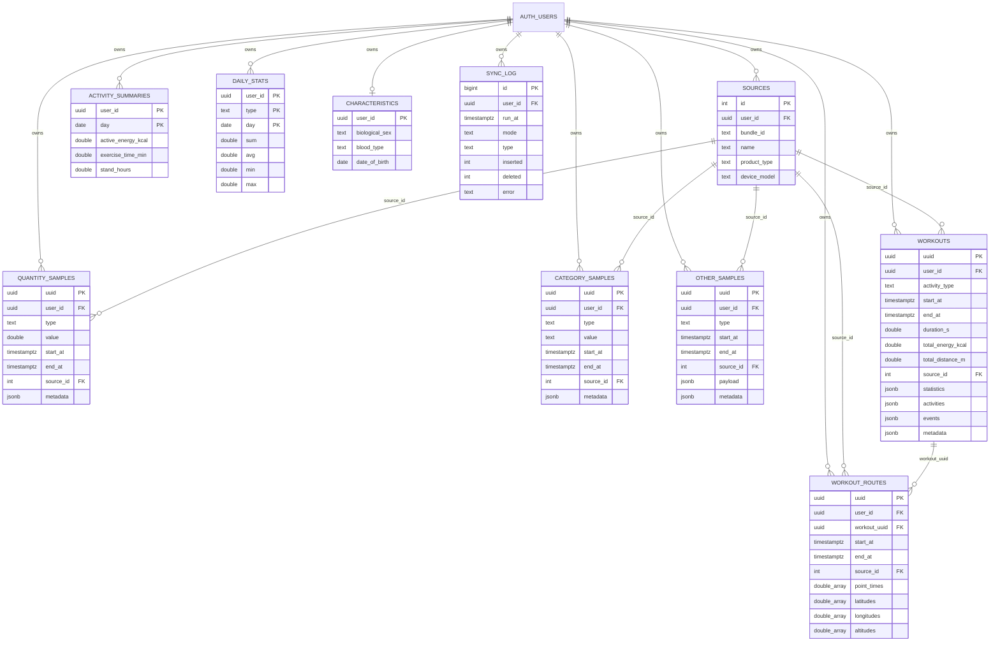

# DB 설계서

## 1. 개요

- DB는 Supabase의 Postgres이며, 아이폰 HealthKit 데이터를 사용자별로 저장합니다.
- 테이블은 10개이고 모두 `public` 스키마에 있습니다. 모든 테이블에 RLS를 켰습니다.
- 쓰는 쪽은 iOS 앱(로그인한 사용자 세션), 읽는 쪽은 앱과 MCP 서버(사용자 범위로 조회)입니다.
- 테이블 외에 MCP 서버용 조회 함수 6개가 있습니다 (6장).

## 2. 설계 원칙

| 원칙                      | 내용                                                                                            | 이유                                                                                       |
| ------------------------- | ----------------------------------------------------------------------------------------------- | ------------------------------------------------------------------------------------------ |
| 멱등 업로드               | 원본 샘플은 HealthKit UUID를 기본 키로 upsert합니다.                                            | 백필 재개, 재시도, 증분 동기화에서 같은 데이터가 여러 번 올라가도 행이 늘지 않아야 합니다. |
| UTC 저장                  | 시각은 `timestamptz`(UTC)로 저장합니다.                                                         | 시간대에 영향받지 않는 단일 기준을 둡니다.                                                 |
| 일별 날짜는 기기 시간대   | `daily_stats.day`, `activity_summaries.day`는 기기 시간대(서울) 기준 `date`입니다.              | "오늘 걸음 수"가 사용자가 보는 건강 앱과 같은 날짜 경계를 따라야 합니다.                   |
| 합계는 `daily_stats` 우선 | 걸음 수 같은 합계는 기기가 HealthKit 통계 조회로 계산해 올린 값을 씁니다.                       | 원본을 그냥 더하면 아이폰과 워치가 같은 걸음을 중복 기록해 값이 부풀려집니다.              |
| 단위 통일                 | 유형별 표준 단위 하나로 저장하고, 단위 컬럼은 두지 않습니다.                                    | 용량을 아끼기 위해서입니다. 단위 표는 앱 코드(`HealthCatalog.swift`)에 있습니다.           |
| 이름으로 저장             | 유형, 범주 값, 운동 종류는 번호 대신 이름(`heart_rate`, `asleep_deep`, `running`)을 저장합니다. | 이름표 테이블 없이 바로 읽히고, SQL 도구에서 질의하기 쉽습니다.                            |
| 출처 정규화               | 출처(앱, 기기)는 `sources`에 한 번만 저장하고 샘플에는 번호만 둡니다.                           | 수백만 행에 같은 문자열이 반복되는 낭비를 막습니다.                                        |
| 소유자 격리               | 모든 행에 `user_id`가 있고 RLS가 `user_id = auth.uid()`로 거릅니다.                             | 앱과 MCP 서버가 어떤 경로로 접근해도 본인 데이터만 보입니다.                               |

## 3. ER 다이어그램

다이어그램에는 핵심 컬럼만 그렸습니다. 전체 컬럼은 4장에 있습니다.

## 4. 테이블 명세

모든 테이블의 `user_id`는 `uuid not null default auth.uid()`이고 `auth.users(id)`를 참조하며 `on delete cascade`입니다. 앱이 `user_id`를 직접 보내지 않아도 로그인 세션 기준으로 채워집니다. 아래 표에서는 반복을 피하려고 생략합니다.

### 4.1 sources: 출처

| 컬럼         | 타입                  | 설명                        |
| ------------ | --------------------- | --------------------------- |
| id           | integer, identity, PK | 사용자 사이에서 유일한 번호 |
| bundle_id    | text, 기본 `''`       | 기록한 앱의 번들 ID         |
| name         | text, 기본 `''`       | 앱 또는 기기 이름           |
| product_type | text, 기본 `''`       | 기기 모델 식별자            |
| device_model | text, 기본 `''`       | 기기 모델 이름              |

- `unique (user_id, bundle_id, name, product_type, device_model)`: 같은 출처는 한 행입니다. 앱이 이 키로 upsert하고 번호를 돌려받아 캐시합니다.
- `unique (user_id, id)`: 샘플 테이블이 `(user_id, source_id)` 복합 외래 키로 참조하기 위한 제약입니다. 다른 사용자의 출처 번호를 가리키는 행을 DB 수준에서 막습니다.
- 값이 없을 때 null 대신 빈 문자열을 쓰는 이유는, unique 제약에서 null이 서로 다른 값으로 취급되어 중복 행이 생기는 것을 피하기 위해서입니다.

### 4.2 quantity_samples: 수치형 원본

걸음, 심박, 에너지, 체중 등 수치로 표현되는 모든 유형의 원본입니다. 가장 큰 테이블입니다.

| 컬럼             | 타입               | 설명                                     |
| ---------------- | ------------------ | ---------------------------------------- |
| uuid             | uuid, PK           | HealthKit 샘플 UUID                      |
| type             | text               | 유형 이름 (예: `heart_rate`). snake_case |
| value            | double precision   | 유형별 표준 단위의 값                    |
| start_at, end_at | timestamptz        | 측정 구간. `end_at >= start_at` 검사     |
| source_id        | integer, null 허용 | `sources` 참조 (복합 외래 키)            |
| metadata         | jsonb, null 허용   | 필요한 유형에만 남기는 부가 정보         |

### 4.3 category_samples: 범주형 원본

수면 단계처럼 값이 이름으로 정해진 유형입니다. 구조는 `quantity_samples`와 같고 `value`만 `text`입니다 (예: `asleep_deep`, `in_bed`).

### 4.4 other_samples: 그 밖의 원본

심전도, 심박 박동 간격, 청력, 마음 상태, 설문(GAD-7, PHQ-9), 시력 처방, 복약 기록처럼 구조가 제각각인 유형입니다. 컬럼을 유형별로 만들면 테이블이 지나치게 늘어나므로 유형별 고유 내용은 `payload jsonb not null`에 담습니다. 나머지 컬럼은 `quantity_samples`와 같습니다 (`value` 대신 `payload`).

### 4.5 workouts: 운동

| 컬럼                                     | 타입                       | 설명                                                         |
| ---------------------------------------- | -------------------------- | ------------------------------------------------------------ |
| uuid                                     | uuid, PK                   | 운동 UUID                                                    |
| activity_type                            | text                       | 운동 종류 이름 (예: `running`)                               |
| start_at, end_at                         | timestamptz                | 운동 구간                                                    |
| duration_s                               | double precision, not null | 운동 시간(초)                                                |
| total_energy_kcal                        | double precision           | 총 소모 에너지(kcal)                                         |
| total_distance_m                         | double precision           | 총 이동 거리(m)                                              |
| source_id                                | integer                    | `sources` 참조                                               |
| statistics, activities, events, metadata | jsonb                      | 운동 중 통계, 세부 활동 구간, 이벤트(일시정지 등), 부가 정보 |

운동 시간, 에너지, 거리는 자주 묻는 값이라 컬럼으로 꺼내 두고, 구조가 복잡한 나머지는 jsonb로 둡니다.

### 4.6 workout_routes: 운동 경로

| 컬럼                  | 타입                          | 설명                                       |
| --------------------- | ----------------------------- | ------------------------------------------ |
| uuid                  | uuid, PK                      | 경로 UUID                                  |
| workout_uuid          | uuid, null 허용               | `workouts(uuid)` 참조, `on delete cascade` |
| start_at, end_at      | timestamptz                   | 경로 구간                                  |
| source_id             | integer                       | `sources` 참조                             |
| point_times           | double precision[]            | 점별 시각 (Unix 시각, 초)                  |
| latitudes, longitudes | double precision[]            | 점별 좌표                                  |
| altitudes             | double precision[], null 허용 | 점별 고도                                  |

- GPS 점을 한 행씩 저장하면 행 수가 폭증하므로 경로 하나를 배열 컬럼 한 행으로 저장합니다.
- 검사 제약으로 `point_times`, `latitudes`, `longitudes`의 길이가 같아야 합니다.
- 위치 정보는 민감 정보이므로 MCP 도구 설계 때 노출 범위를 따로 정합니다.

### 4.7 activity_summaries: 활동 링

| 컬럼                                        | 타입             | 설명                  |
| ------------------------------------------- | ---------------- | --------------------- |
| day                                         | date             | 기기 시간대 기준 날짜 |
| active_energy_kcal, active_energy_goal_kcal | double precision | 무브 링 값과 목표     |
| move_time_min, move_time_goal_min           | double precision | 이동 시간과 목표      |
| exercise_time_min, exercise_time_goal_min   | double precision | 운동 시간과 목표      |
| stand_hours, stand_hours_goal               | double precision | 일어서기 시간과 목표  |
| updated_at                                  | timestamptz      | 마지막 갱신 시각      |

기본 키는 `(user_id, day)`입니다. 하루 한 행을 덮어씁니다.

### 4.8 daily_stats: 일별 통계

기기가 HealthKit 통계 조회(출처 중복을 제거한 결과)로 계산해 올리는 일별 집계입니다.

| 컬럼               | 타입                        | 설명                                                                                             |
| ------------------ | --------------------------- | ------------------------------------------------------------------------------------------------ |
| day                | date                        | 기기 시간대 기준 날짜                                                                            |
| type               | text                        | 유형 이름                                                                                        |
| sum, avg, min, max | double precision, null 허용 | 유형의 성격에 맞는 값만 채웁니다. 합계형(걸음 등)은 `sum`, 측정형(심박 등)은 `avg`, `min`, `max` |
| updated_at         | timestamptz                 | 마지막 갱신 시각                                                                                 |

- 기본 키는 `(user_id, type, day)`입니다. 같은 날을 다시 계산해 올리면 덮어씁니다.
- 합계가 소수일 수 있습니다. HealthKit이 날짜 경계에 걸친 기록을 비율로 나누기 때문이며, 건강 앱은 반올림해 보여 줍니다.
- 늦게 들어오는 워치 데이터를 반영하려고 3단계에서 당일과 전날을 매번 다시 계산해 덮어쓸 예정입니다.

### 4.9 characteristics: 고정 정보

사용자당 한 행입니다 (`user_id`가 기본 키). 생물학적 성별, 혈액형, 생년월일, 피츠패트릭 피부 유형, 휠체어 사용 여부, 활동 이동 모드를 담습니다. 값이 없으면 null입니다.

### 4.10 sync_log: 동기화 기록

| 컬럼              | 타입                      | 설명                                                                    |
| ----------------- | ------------------------- | ----------------------------------------------------------------------- |
| id                | bigint, identity, PK      | 기록 번호                                                               |
| run_at            | timestamptz, 기본 `now()` | 실행 시각                                                               |
| mode              | text, not null            | `backfill`, `observer`, `background_task`, `manual` 중 하나 (검사 제약) |
| type              | text                      | 대상 유형 이름. 전체 실패 등은 null                                     |
| inserted, deleted | integer, 기본 0           | 올린 건수와 지운 건수                                                   |
| error             | text                      | 오류 메시지                                                             |

기록은 쌓기만 하므로 앱 권한은 select와 insert뿐입니다. 수정과 삭제는 막혀 있습니다.

## 5. 인덱스

| 인덱스                                 | 대상                        | 쓰임새                           |
| -------------------------------------- | --------------------------- | -------------------------------- |
| `quantity_samples_user_type_start_idx` | `(user_id, type, start_at)` | 유형별 기간 조회                 |
| `category_samples_user_type_start_idx` | `(user_id, type, start_at)` | 수면 등 기간 조회                |
| `other_samples_user_type_start_idx`    | `(user_id, type, start_at)` | 유형별 기간 조회                 |
| `workouts_user_start_idx`              | `(user_id, start_at)`       | 기간별 운동 목록                 |
| `workout_routes_workout_idx`           | `(workout_uuid)`            | 운동에서 경로 찾기, cascade 삭제 |
| `sync_log_user_run_at_idx`             | `(user_id, run_at desc)`    | 최근 동기화 기록                 |

- `daily_stats`와 `activity_summaries`는 기본 키가 곧 조회 키라 별도 인덱스가 없습니다.
- 수치형 원본은 약 208만 행(442MB)으로 용량의 대부분을 차지합니다. 인덱스는 위의 하나만 두어 크기를 억제합니다. 인덱스를 추가할 때는 용량 영향을 먼저 잰 뒤 결정합니다.

## 6. 보안 (RLS와 권한)

- 모든 테이블에 RLS를 켰습니다.
- 마이그레이션은 `authenticated` 역할에만 권한을 줍니다. Supabase 기본 설정으로 `anon`에 권한이 붙어 있는지는 확인하지 못했습니다. 붙어 있더라도 정책이 `authenticated`에만 열려 있어 `anon`은 행을 읽거나 쓸 수 없습니다.
- 정책은 테이블마다 하나씩이며 `user_id = (select auth.uid())`로 읽기와 쓰기를 모두 거릅니다. `(select auth.uid())` 형태는 행마다 함수를 다시 부르지 않고 한 번만 평가하게 하려는 것입니다.
- `sync_log`는 select와 insert 정책만 있습니다.
- 서비스 키(`service_role`)는 앱이나 저장소에 넣지 않습니다. 앱은 공개 키와 로그인 세션만 씁니다.
- MCP 서버도 사용자 토큰으로 접근해 같은 RLS가 그대로 적용되게 합니다. `run_sql` 도구도 RLS를 우회하지 못하도록 사용자 권한(`security invoker`)으로 실행되는 함수로 감쌉니다.

### MCP 조회 함수

`20261021072900_mcp_functions.sql`의 함수 6개입니다. 모두 `security invoker`라 호출한 사용자의 권한과 RLS로 실행되고, `authenticated`에만 실행 권한을 줍니다 (`public`, `anon`은 회수).

| 함수                                       | 하는 일                                                                                                                                                                            |
| ------------------------------------------ | ---------------------------------------------------------------------------------------------------------------------------------------------------------------------------------- |
| `mcp_list_metrics()`                       | `daily_stats`, `category_samples`, `other_samples`의 유형별 기간과 건수, 운동과 활동 링 요약. 수치형 원본(200만 행)은 세지 않고 `daily_stats`로 갈음합니다.                        |
| `mcp_daily_summary(from, to)`              | 일별 걸음, 활동 에너지, 운동 시간 (`daily_stats`)                                                                                                                                  |
| `mcp_sleep_summary(from, to, tz)`          | 밤별 수면 단계 시간, 취침과 기상 시각, 평균. 밤은 18시를 경계로 기상한 날짜에 묶습니다.                                                                                            |
| `mcp_workouts(from, to, limit, tz)`        | 기간별 운동 목록과 종류별 요약                                                                                                                                                     |
| `mcp_metric_trend(type, from, to, bucket)` | `daily_stats` 한 유형의 일, 주, 월 추이                                                                                                                                            |
| `mcp_run_sql(query, max_rows)`             | 읽기 전용 SQL. `select`/`with` 한 문장만 받고, `stable`이라 데이터 변경문은 실행되지 않으며, 최대 1000행입니다. 시간 제한은 `authenticated` 역할의 `statement_timeout`(8초)입니다. |

## 7. 용량 계획

| 항목                             | 값                                                                                |
| -------------------------------- | --------------------------------------------------------------------------------- |
| 무료 한도                        | 500MB                                                                             |
| 전체 백필 결과 (2026-10-21 측정) | 수치형 원본 약 208만 행(442MB, 인덱스 정리 후) + 나머지 테이블 약 33MB            |
| 원격 현재 크기 | 약 172MB (2026-10-26) |
| 경고 기준                        | 350MB                                                                             |
| 결정 기준                        | 450MB (Pro 전환, 고빈도 원본을 집계로 대체 후 삭제, 오래된 원본 내보내기 중 선택) |

원격에는 수치형 원본을 유형별 기간(심박수 6개월, 고빈도 유형 3개월, 그 밖은 전체)으로 제한해 올리고 `daily_stats`는 전체 기간을 올립니다. 합계 약 151MB를 예상합니다 (수치형 원본 약 99MB, 나머지 테이블 약 52MB). 2026-10-21에 정한 범위입니다.

- 심박수(`heart_rate`): 최근 6개월 (약 26MB)
- 전체 기간: 달리기 지표 5종(`running_speed`, `running_power`, `running_vertical_oscillation`, `running_ground_contact_time`, `running_stride_length`)과 아래 두 묶음에 속하지 않는 저빈도 유형 (체중, 심박 변이도, 안정 시 심박, VO2 max 등). 합쳐서 약 26MB
- 최근 3개월: 활동 에너지, 기초 에너지, 걷기·달리기 거리, 걸음 수, 신체 활동량, 걷기 지표 4종, 소음 노출 2종, 호흡수, 계단 속도 2종, 소음 감소, 오른 층수, 사이클링 거리 (약 47MB)
- 원본 제외: `apple_exercise_time`, `apple_stand_time` (활동 링 값이 `activity_summaries`에 있음)

줄인 기간의 원본은 원격에 올리지 않고 기기의 HealthKit에만 있습니다. DB가 450MB에 가까워지면 먼저 정기 정리 SQL로 보관 기간을 넘은 원본을 지우고, 그래도 부족하면 보관 기간을 줄이며(고빈도 3개월을 2개월로 등), 그다음에 Pro 전환(월 25달러)을 검토합니다. 보관 기간을 넘은 원본은 월 1회 지웁니다 (`supabase/README.md`의 "운영").

## 8. 마이그레이션 규칙

- 구조 변경은 `supabase migration new <이름>`으로 만든 마이그레이션 파일로만 합니다. 대시보드에서 직접 고치지 않습니다.
- 시험용 DB가 따로 없으므로, 적용 전에 SQL을 다시 읽고 `supabase db push --dry-run`으로 대상을 확인한 뒤 사용자 확인을 받아 `supabase db push`로 원격에 적용합니다.
- 이미 원격에 적용한 마이그레이션을 지울 때는 `supabase migration repair`로 원격 이력도 맞춥니다.

## 9. 앞으로 바뀔 수 있는 부분

- 3단계: 증분 동기화에서 삭제된 샘플을 처리하려면 앵커 값을 기기에 저장해야 하며, 이는 기기 쪽 상태이므로 DB 변경은 필요 없을 것으로 봅니다. 구현하면서 확인합니다.
- 5단계: 토큰 검증을 붙여도 함수는 사용자 권한으로 실행되므로 DB 변경은 필요 없을 것으로 봅니다. 구현하면서 확인합니다.
